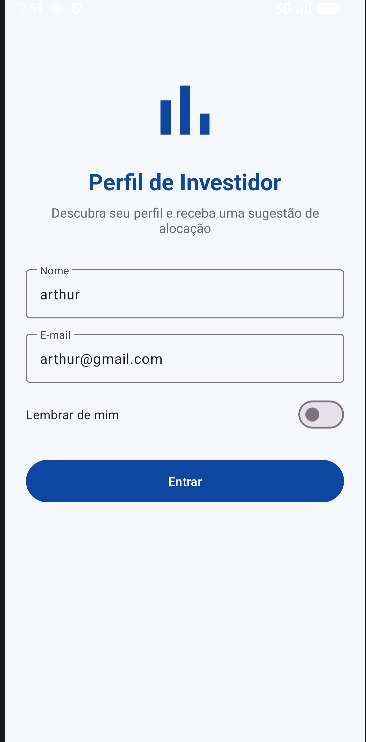
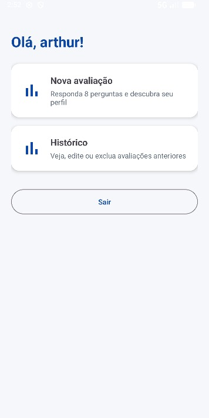
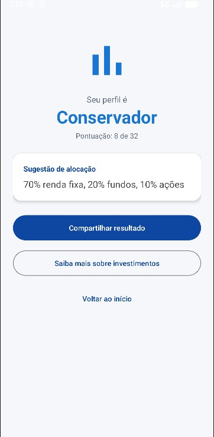
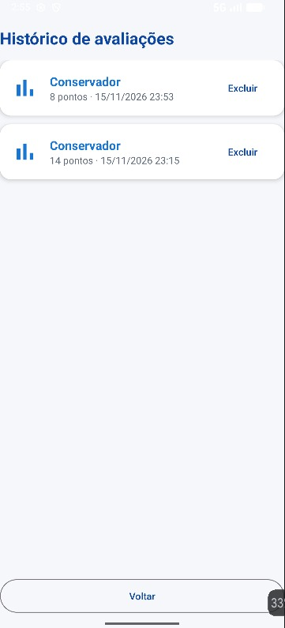

# Perfil de Investidor

Aplicativo Android (Kotlin) que aplica um questionário de perfil de investidor, classifica o usuário como **Conservador**, **Moderado** ou **Arrojado** e guarda o histórico de avaliações em uma API REST própria.

## Descrição da proposta

O usuário se identifica (nome e e-mail), responde 8 perguntas de múltipla escolha sobre objetivos, experiência e tolerância a risco, e recebe:

- a **pontuação** total (8 a 32 pontos);
- o **perfil** de investidor correspondente;
- uma **recomendação de alocação** (renda fixa, fundos e ações).

Cada avaliação fica salva no servidor e pode ser consultada no histórico, ter a observação editada ou ser excluída (CRUD completo). O resultado também pode ser compartilhado e há um link para um site externo por meio de intents implícitas.

| Pontuação | Perfil | Recomendação |
|---|---|---|
| 8 a 15 | Conservador | 70% renda fixa, 20% fundos, 10% ações |
| 16 a 24 | Moderado | 50% renda fixa, 30% fundos, 20% ações |
| 25 a 32 | Arrojado | 20% renda fixa, 30% fundos, 50% ações |

## Tecnologias utilizadas

**Aplicativo (`android/`)**
- Kotlin + layouts XML (View System)
- Retrofit 2 + Gson (consumo da API)
- RecyclerView + CardView (histórico)
- Material Components, ConstraintLayout, AndroidX
- Gradle (Kotlin DSL)

**API (`backend/`)**
- Python 3.10+
- FastAPI + Uvicorn
- SQLAlchemy + SQLite
- Pydantic v2
- Pytest + HTTPX (testes)

## Estrutura do projeto

```
.
├── android/   # app Android (Kotlin)
├── backend/   # API FastAPI (app/ e tests/)
└── docs/      # documentação da API e screenshots
```

## Instruções de execução

### 1. Subir a API

Requisitos: Python 3.10+.

```bash
cd backend

# criar e ativar o ambiente virtual
python -m venv .venv
.venv\Scripts\activate          # Windows (PowerShell/CMD)
# source .venv/bin/activate     # Linux/macOS

# instalar as dependências
pip install -r requirements.txt

# iniciar o servidor
python -m uvicorn app.main:app --reload
```

- API: http://localhost:8000
- Swagger: http://localhost:8000/docs

O banco SQLite (`backend/investidor.db`) é criado automaticamente na primeira execução.

**Testes automatizados**

```bash
cd backend
python -m pytest -q
```

### 2. Executar o app Android

Requisitos: Android Studio recente (com JDK e Android SDK) e a API em execução.

1. Abra a pasta `android/` no Android Studio e aguarde a sincronização do Gradle.
2. **Emulador:** nenhuma alteração é necessária — o app acessa a API em `http://10.0.2.2:8000`.
3. **Celular físico:**
   - suba a API acessível na rede: `python -m uvicorn app.main:app --host 0.0.0.0`;
   - altere `BASE_URL` em `android/app/src/main/java/com/arthur/investidor/data/api/RetrofitClient.kt` para o IP do PC (ex.: `http://192.168.0.10:8000/`), com celular e PC na mesma rede Wi-Fi.
4. Execute o app (▶ Run).

### Telas do app

Login → Home → Questionário → Resultado, mais Histórico (lista com exclusão e confirmação) e Detalhe (respostas e edição da observação).

## Screenshots

| Login | Home | Questionário |
|:---:|:---:|:---:|
|  |  |  |

| Resultado | Compartilhar resultado | Histórico de avaliações |
|:---:|:---:|:---:|
|  |  |  |

## Descrição da API

API REST em JSON. Base URL: `http://localhost:8000` (emulador Android: `http://10.0.2.2:8000`).

| Método | Rota | Descrição | Sucesso | Erros |
|---|---|---|---|---|
| POST | `/usuarios` | Cadastra usuário (ou retorna o existente pelo e-mail) | 201 / 200 | 422 |
| GET | `/usuarios/{id}` | Consulta usuário | 200 | 404 |
| GET | `/perguntas` | Lista perguntas e opções (valor 1–4) | 200 | — |
| POST | `/avaliacoes` | Recebe respostas, calcula pontuação e perfil e salva | 201 | 404, 422 |
| GET | `/avaliacoes?usuario_id={id}` | Histórico do usuário (mais recentes primeiro) | 200 | — |
| GET | `/avaliacoes/{id}` | Detalhe da avaliação com respostas | 200 | 404 |
| PUT | `/avaliacoes/{id}` | Altera a observação | 200 | 404, 422 |
| DELETE | `/avaliacoes/{id}` | Remove avaliação e respostas | 204 | 404 |

Exemplo — `POST /avaliacoes`:

```json
{ "usuario_id": 1,
  "respostas": [ {"pergunta_id": 1, "valor": 3}, {"pergunta_id": 2, "valor": 2} ] }
```

Regras: a avaliação deve conter resposta para **todas** as perguntas (valor 1–4), caso contrário retorna 422.

Detalhes completos, modelo de dados e mais exemplos em [docs/API.md](docs/API.md).

## Swagger

Com a API em execução, a documentação interativa está disponível em:

- **Swagger UI:** http://localhost:8000/docs
- OpenAPI JSON: http://localhost:8000/openapi.json
